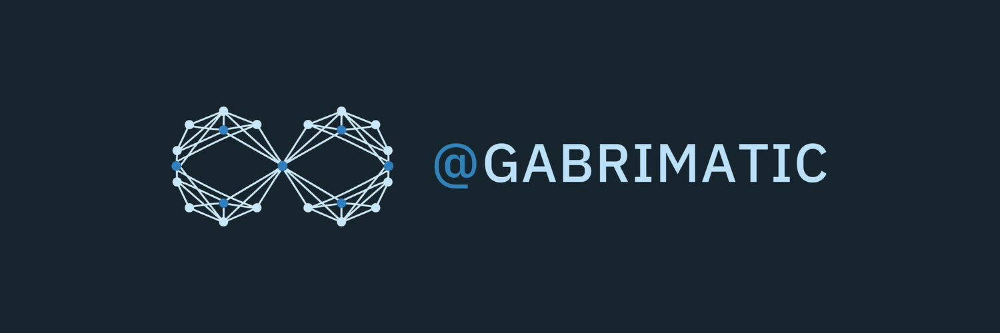

  

# Hi, I'm Soroush 👋

I'm Soroush Yousefpour (gabrimatic), a senior software engineer in Berlin. I build mobile apps and AI tools, with a focus on local inference, voice, and coding agents.

I started with native Android and iOS development and have worked with Flutter in production since 2019.

## 🎙️ Local AI

- [Local Whisper](https://github.com/gabrimatic/local-whisper): on-device dictation and transcription for macOS, iOS, and Android, with desktop shortcuts and mobile keyboards.
- [kokoro-mlx](https://github.com/gabrimatic/kokoro-mlx) and [qwen3-asr-mlx](https://github.com/gabrimatic/qwen3-asr-mlx): MLX inference libraries for Kokoro text-to-speech and Qwen3-ASR speech recognition on Apple Silicon.
- [OCR Capture](https://github.com/gabrimatic/ocr-capture): copy text from a screen region or image using Apple's on-device Vision framework.
- [Threadstone](https://github.com/gabrimatic/threadstone): offline terminal chat with MLX models on Apple Silicon, with streaming replies and session recovery.
- [Ollama Flutter GUI](https://github.com/gabrimatic/ollama_flutter_gui) and [personal_ollama_cli](https://github.com/gabrimatic/personal_ollama_cli): a Flutter Web interface and a terminal client for local Ollama models.

## 🧩 Flutter and Dart

### [Contributions to Flutter](https://www.gabrimatic.info/flutter-sdk)

In April 2026 I started fixing Flutter itself. Not a package around it: the framework every Flutter app runs on. I've contributed fixes and improvements to Flutter's rendering, animation, and accessibility code.

Everything that landed is here, newest first: [gabrimatic.info/flutter-sdk](https://www.gabrimatic.info/flutter-sdk). The pull requests themselves: [flutter/flutter](https://github.com/flutter/flutter/pulls?q=is%3Apr+author%3Agabrimatic).

### Apps and packages

- [restart_app](https://github.com/gabrimatic/restart_app): restart or relaunch Flutter apps across mobile, desktop, and web, with platform-specific behavior.
- [PassesBox](https://github.com/gabrimatic/passes_box): an offline password manager.
- [otp_auth](https://github.com/gabrimatic/otp_auth): generate and verify HOTP and TOTP one-time passwords in Dart.
- [graphql_fragment_builder](https://github.com/gabrimatic/graphql_fragment_builder): build GraphQL queries, variables, and reusable fragments in Dart.
- [persian_datetimepickers](https://github.com/gabrimatic/persian_datetimepickers): Jalali (Persian) and Gregorian date and time pickers for Flutter.
- [center_the_widgets](https://github.com/gabrimatic/center_the_widgets): keep mobile layouts centered and readable on larger screens.
- [flutter_chrome_extension](https://github.com/gabrimatic/flutter_chrome_extension): a Manifest V3 Chrome extension starter built with Flutter Web.

[Packages on pub.dev](https://pub.dev/publishers/gabrimatic.info/packages)

## 🛠️ Tools for agents

- [tmux-mcp](https://github.com/gabrimatic/tmux-mcp): persistent terminals for AI agents. You can attach to the same session, see what's happening, and take over.
- [MCP Web Search Tool](https://github.com/gabrimatic/mcp-web-search-tool): web search, page reading, and source citations for assistants.
- [mcp-prose-memory](https://github.com/gabrimatic/mcp-prose-memory): structured memory that agents can keep across sessions.
- [Copilot Goal System](https://github.com/gabrimatic/copilot-goal-system): persistent goals, progress tracking, and completion checks for longer Copilot tasks.
- [Agent Flight Recorder](https://github.com/gabrimatic/agent-flight-recorder): a local record of code changes, commands, and test runs to help review an agent's work.
- [Realtime Operator](https://github.com/gabrimatic/realtime-operator): voice control for local tools on your computer, using the OpenAI Realtime API.

## 📷 Beyond code

I'm into photography, books, and cinema, especially film theory and storytelling. I spent two years working in bookstores.

[Website](https://www.gabrimatic.info) · [LinkedIn](https://linkedin.com/in/gabrimatic) · [Writing](https://medium.com/@gabrimatic) · [Photography](https://500px.com/p/gabrimatic)
